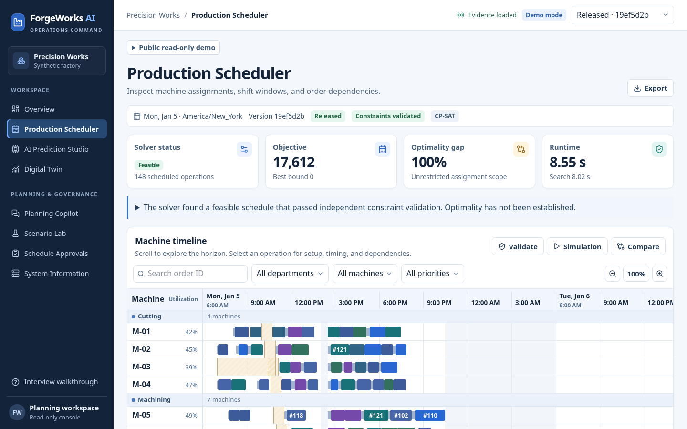

# ForgeWorks AI

ForgeWorks AI is a production-planning command center for a synthetic precision-metal factory. It estimates operation durations, builds independently validated job-shop schedules, models delivery risk, and records planner decisions.

**[Open the public recruiter demo](https://forgeworks-ai-recruiter-demo.sound-rhino-8637.chatgpt.site/)** and choose **Interview walkthrough** for a seven-step tour. The public demo is read-only and requires no account or local setup.

## What the demo shows

- **Manufacturing Overview and Production Scheduler.** Explore the verified 40-order plan, machine assignments, shifts, maintenance windows, setup intervals, and operation dependencies. Download a schedule evidence ZIP from the Scheduler.
- **AI Prediction Studio and Digital Twin.** Compare ML duration estimates with ERP standards. Search, sort, or filter order-level delivery risk from the saved simulation, including the 300-replication run.
- **Planning Copilot and Scenario Lab.** Read deterministic, evidence-backed explanations and compare saved schedule versions. The breakdown replan preserves protected work, and the stored simulation shows the delivery tradeoffs.
- **Schedule Approvals and System Information.** Inspect validation, approval and release history, model versions, and benchmark evidence.

## Architecture

The React and TypeScript command center is built with Vite. The public build reads same-origin JSON and ZIP assets exported from a verified FastAPI fixture. The browser uses hash routes for deep links. The static deployment requires no live backend, database, or planner credentials.

The local deployment connects the same frontend to a FastAPI service through Nginx. SQLite stores local evidence, OR-Tools CP-SAT builds schedules, and the digital twin estimates delivery risk. The CLI and REST API use the same planning services. Authorized local workflows can run new plans and simulations, create scenarios, and record planner decisions. [Frontend architecture](docs/frontend-architecture.md) · [Deployment guide](docs/deployment-guide.md#public-recruiter-release)

```bash
docker compose -p forgeworks-console-demo --profile console up --build command-center
```

Open **http://127.0.0.1:4173** and choose **Interview walkthrough**. The console uses a dedicated SQLite volume. Planner actions require explicitly enabled local server authorization. [Deployment and reset](docs/deployment-guide.md) · [Interview guide](docs/interview-demo-guide.md)



[Overview](docs/screenshots/overview.png) · [Operation details](docs/screenshots/operation-detail.png) · [Prediction Studio](docs/screenshots/predictions.png) · [Digital Twin](docs/screenshots/digital-twin.png) · [Scenario Lab](docs/screenshots/scenario-lab.png)

## Synthetic-data limitations

The factory, operating records, and disturbances are synthetic. On the held-out synthetic data, the forest model achieved **14.34 minutes MAE** versus **24.08 minutes** for the ERP baseline, with **90.56%** observed interval coverage. These results describe the fixture. Real factory performance still requires field validation and calibration.

A feasible schedule satisfies the independently checked constraints. A solver status of FEASIBLE leaves optimality open. The unrestricted 200-order CP-SAT benchmark reached its construction guard. The fixed-assignment version passed validation and tied the EDD objective. Digital-twin figures estimate outcomes under modeled rules and disturbances. Production execution integration and production identity controls remain open. [Known limitations](docs/limitations.md)

[Frontend architecture](docs/frontend-architecture.md) · [API integration](docs/frontend-integration-plan.md) · [Security review](docs/frontend-security.md) · [Test instructions](docs/frontend-testing.md) · [Frontend delivery report](reports/frontend-final-delivery.md)

## Backend quickstart

```bash
python3.12 -m venv .venv
source .venv/bin/activate
pip install -r requirements.lock
pip install --no-deps -e .
alembic upgrade head
python -m forgeworks generate --scenario normal --seed 42 --count 6
python -m forgeworks optimize --seconds 5
uvicorn forgeworks.api:app --host 127.0.0.1 --port 8000
```

The local [Swagger UI](http://127.0.0.1:8000/docs) shows typed requests and job polling. The default SQLite file is `forgeworks.db`.

```bash
export FORGEWORKS_PLANNER_TOKEN=local-demo-only
python examples/demo.py --output demo-output --runs 300 --seconds 8
python -m forgeworks benchmark --count 6 --runs 100 --seconds 5 --scale \
  --output demo-output/benchmark-results.json
```

The demo writes exports, validation evidence, approval records, paired Monte Carlo comparisons, and execution feedback. Dataset contents and Monte Carlo draws are seed-reproducible. Run IDs, wall time and time-limited solver incumbents can vary. The planner token is a demonstration control for localhost or a trusted internal network.

| Topic | Reference |
|---|---|
| Results and audit | [Delivery report](reports/final-delivery.md), [Adversarial audit](reports/final-adversarial-validation.md) |
| Factory and workflow | [Business case](docs/business-case.md), [Architecture](docs/system-architecture.md), [Data model](docs/data-model.md) |
| Modeling | [Duration prediction](docs/ml-methodology.md), [Optimization](docs/optimization-model.md), [Digital twin](docs/digital-twin.md) |
| Planner use | [Copilot](docs/copilot-design.md), [API](docs/api-reference.md), [Operations](docs/operations-guide.md) |
| Scope | [Limitations](docs/limitations.md), [Case study](docs/portfolio-case-study.md) |
