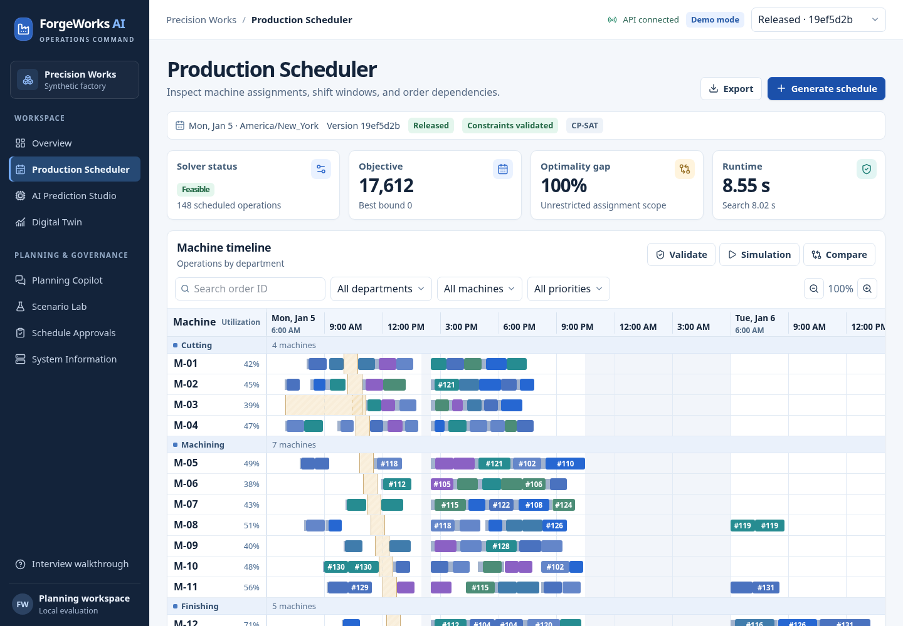

# ForgeWorks AI

ForgeWorks is a local production-planning backend for a synthetic precision-metal factory. It estimates processing durations, solves and independently validates flexible job-shop schedules, evaluates delivery risk in a digital twin, and records planner approval and release. The CLI and REST API use the same services.

## Manufacturing Operations Command Center

The React command center makes the existing FastAPI planning workflow available through eight workspaces. Inspect the persisted Gantt, model measurements, simulation replications, scenario comparisons, and decision history. The interview fixture loads the published 40-order plan and its 300-replication evidence without a fresh solve.

```bash
docker compose -p forgeworks-console-demo --profile console up --build command-center
```

Open **http://127.0.0.1:4173** and choose **Interview walkthrough**. The console uses a dedicated SQLite volume. Planner actions require explicitly enabled local server authorization. [Deployment and reset](docs/deployment-guide.md) · [Interview guide](docs/interview-demo-guide.md)



[Overview](docs/screenshots/overview.png) · [Operation details](docs/screenshots/operation-detail.png) · [Prediction Studio](docs/screenshots/predictions.png) · [Digital Twin](docs/screenshots/digital-twin.png) · [Scenario Lab](docs/screenshots/scenario-lab.png)

The synthetic evaluation reproduced **14.34-minute forest MAE** versus **24.08-minute ERP MAE**, with **90.56%** observed interval coverage. Unrestricted 200-order CP-SAT still reaches its construction guard. Fixed assignment validated at that size and tied the EDD objective. Digital-twin estimates reflect synthetic disturbances and modeled rules. Production execution integration, authorization, and plant calibration remain open.

[Frontend architecture](docs/frontend-architecture.md) · [API integration](docs/frontend-integration-plan.md) · [Security review](docs/frontend-security.md) · [Test instructions](docs/frontend-testing.md) · [Frontend delivery report](reports/frontend-final-delivery.md)

## Backend quickstart

```bash
python3.12 -m venv .venv
source .venv/bin/activate
pip install -r requirements.lock
pip install --no-deps -e .
alembic upgrade head
python -m forgeworks generate --scenario normal --seed 42 --count 6
python -m forgeworks optimize --seconds 5
uvicorn forgeworks.api:app --host 127.0.0.1 --port 8000
```

The local [Swagger UI](http://127.0.0.1:8000/docs) shows typed requests and job polling. The default SQLite file is `forgeworks.db`.

```bash
export FORGEWORKS_PLANNER_TOKEN=local-demo-only
python examples/demo.py --output demo-output --runs 300 --seconds 8
python -m forgeworks benchmark --count 6 --runs 100 --seconds 5 --scale \
  --output demo-output/benchmark-results.json
```

The demo writes exports, validation evidence, approval records, paired Monte Carlo comparisons, and execution feedback. Dataset contents and Monte Carlo draws are seed-reproducible. Run IDs, wall time and time-limited solver incumbents can vary. The planner token is a demonstration control for localhost or a trusted internal network.

| Topic | Reference |
|---|---|
| Results and audit | [Delivery report](reports/final-delivery.md), [Adversarial audit](reports/final-adversarial-validation.md) |
| Factory and workflow | [Business case](docs/business-case.md), [Architecture](docs/system-architecture.md), [Data model](docs/data-model.md) |
| Modeling | [Duration prediction](docs/ml-methodology.md), [Optimization](docs/optimization-model.md), [Digital twin](docs/digital-twin.md) |
| Planner use | [Copilot](docs/copilot-design.md), [API](docs/api-reference.md), [Operations](docs/operations-guide.md) |
| Scope | [Limitations](docs/limitations.md), [Case study](docs/portfolio-case-study.md) |
