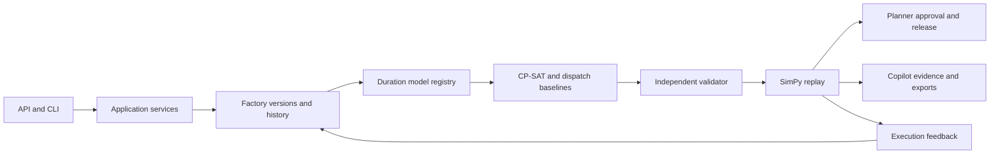

# System architecture

The API uses one worker with up to four admitted jobs, including the running job. Short queries use synchronous FastAPI handlers. Long jobs save the immutable request, status and result IDs. Interrupted jobs become failed after a restart. The CLI calls the same implementations synchronously. SQLite serializes writes with an immediate transaction. PostgreSQL serializes writes through a transaction advisory lock.

Scheduling records preserve the dataset hash, model ID or ERP fallback, rounded durations, weights, solver status, runtime, seed, bound, independent validation and lifecycle. Simulations preserve configuration, random seed, summary and individual outcomes. Scenario alternatives reference their parent and log requested input changes.
