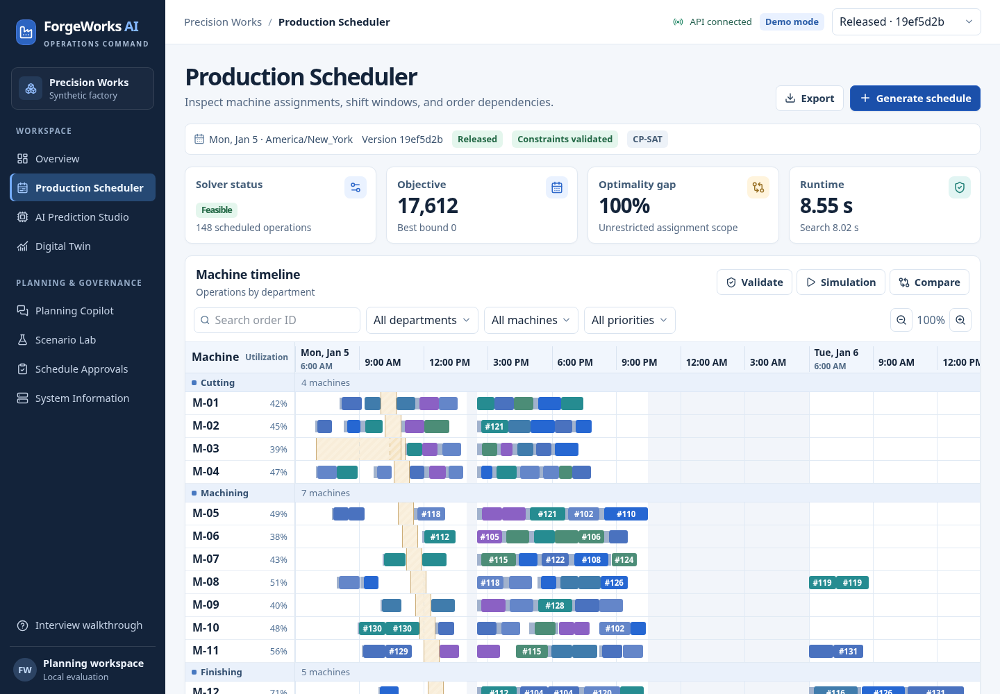

# Manufacturing Operations Command Center delivery

The command center adds eight interactive React workspaces to the reviewed FastAPI application. The main scheduling, simulation, optimization, explanation and approval services remain authoritative.

| Workspace | Shipped workflow |
|---|---|
| Overview | Version-scoped workload, nominal lateness, simulation risk, and persisted activity |
| Production Scheduler | Department and machine timeline, filters, zoom, operation details, validation, optimization, simulation and export |
| AI Prediction Studio | Stored duration estimates, ERP values, intervals, historical synthetic group means and model evaluation |
| Digital Twin | Seeded simulation jobs, previous runs, replication distributions, confidence intervals and risk ranking |
| Planning Copilot | Deterministic structured questions, evidence IDs, assignments, bottlenecks and schedule comparisons |
| Scenario Lab | Validated disruptions, paired simulation, comparison metrics, moved operations and protected commitments |
| Schedule Approvals | Review and confirmed actions through the backend state machine |
| System Information | Health, database, model versions, benchmark and limitations |

## Demo and screenshots

```bash
docker compose -p forgeworks-console-demo --profile console up --build command-center
```

Open `http://127.0.0.1:4173` and select **Interview walkthrough**. The fixture loads the verified 40-order, 148-operation workflow and 300-replication evidence before serving the first view. The initial demo needs no fresh CP-SAT solve. [Deployment and isolated reset](../docs/deployment-guide.md) · [Interview walkthrough](../docs/interview-demo-guide.md)



[Overview](../docs/screenshots/overview.png) · [Operation details](../docs/screenshots/operation-detail.png) · [Prediction Studio](../docs/screenshots/predictions.png) · [Digital Twin](../docs/screenshots/digital-twin.png) · [Scenario Lab](../docs/screenshots/scenario-lab.png)

## Verification

Python lint and type checks passed. The backend suite passed 33 tests, including five new console tests. Frontend strict TypeScript and the production build passed. Vitest passed nine tests. Six Playwright cases passed. The principal suite ran against isolated real FastAPI and SQLite services. It exercised demo navigation, stored evidence, operation selection, live jobs, scenario refresh, approval and release, invalid versions, connection recovery, mobile layout and viewport clipping of a validated 715-operation plan.

A measured local Chromium run presented the overview in approximately 1.60 seconds from navigation to the verified order count. It rendered 148 schedule operations. This is a single local observation, with no performance guarantee. The production build split the main JavaScript bundle to about 124 kB gzip, with the chart workspace loaded separately. [Verification commands](../docs/frontend-testing.md) · [Adversarial audit](frontend-adversarial-validation.md)

## Integration and limits

The added API projections provide schedule discovery, factory calendars, load inputs, persisted risk series, model evidence and decision history. The OpenAPI-generated frontend types cover the declared Pydantic contracts. Job polling and idempotency continue to use the existing backend. Results remain scoped to the selected schedule and simulation IDs.

Planner secrets are consumed on the server. Interactive releases are limited to a trusted local console, and the read-only mode disables mutations and copilot writes. Production authorization, live execution-state integration, field calibration and unrestricted large-instance optimization remain open. [Integration plan](../docs/frontend-integration-plan.md) · [Security review](../docs/frontend-security.md)

Branch `feature/manufacturing-command-center` was created from main at `cae97609a0a31361f1fdc54ea7a379565a32c8c9`. The console API and fixture implementation begins at `b9cb381`. [Branch comparison](https://github.com/vtooooooo/forgeworks/compare/main...feature/manufacturing-command-center)
